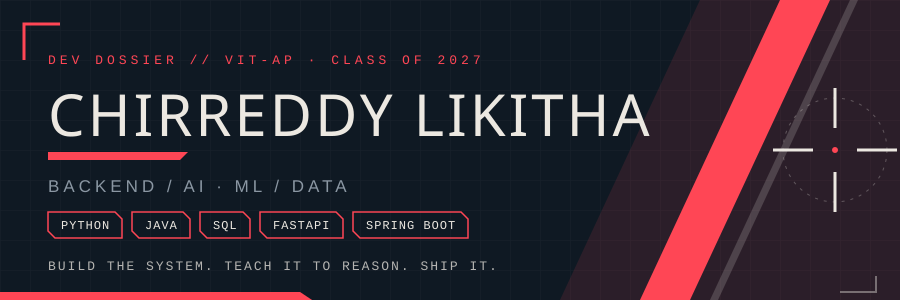
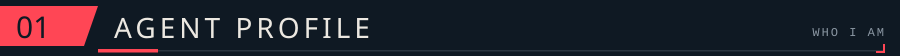
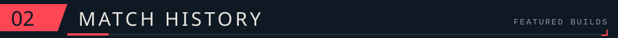
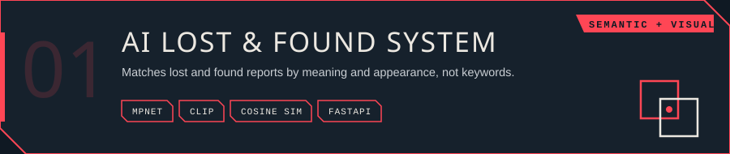
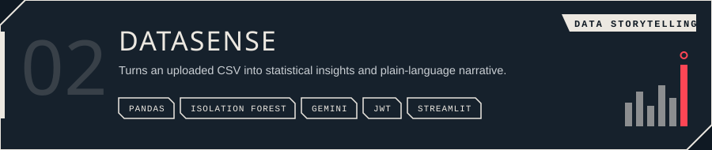
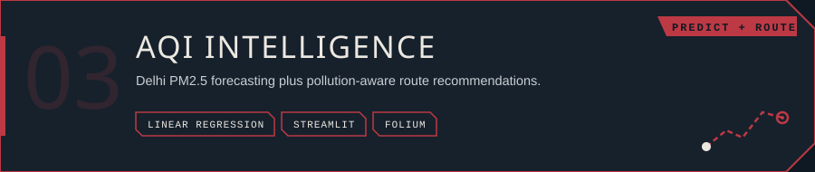
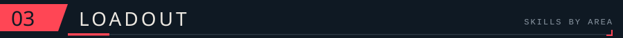
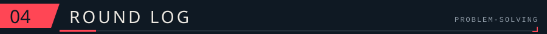
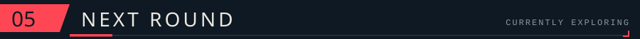
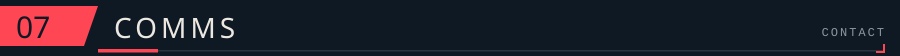

<!-- VALORANT-INSPIRED PROFILE README -->

 

### HEY, I'M LIKITHA 👋
**Computer Science Engineering Student | Backend Development | Applied AI/ML**

Building practical applications by combining backend engineering, machine learning, and data-driven problem-solving.

---

- 🎓 Fourth-year Computer Science Engineering student at **VIT-AP University**.
- 💻 Interested in **backend engineering, applied AI/ML, and data-driven applications**.
- 🧠 Exploring how machine learning models and APIs can solve real-world problems.
- 🛠️ Enjoy building projects that combine problem-solving, backend systems, and intelligent data processing.
- 🎯 Currently strengthening my software development and problem-solving skills.

---

### 01. AI Lost & Found

A similarity-based lost-and-found system that helps match lost and found items using semantic and visual information.

- **Core technologies:** MPNet, CLIP, cosine similarity, FastAPI.
- Uses text and image representations to identify potentially matching items.
- Exposes matching functionality through a backend API.

**Repository:** [AI Lost & Found](https://github.com/likitha8276/ai-lost-and-found)

### 02. DataSense AI — Dataset Storytelling API

An API-focused data analysis project that transforms datasets into understandable insights using statistical analysis and AI-generated explanations.

- **Core technologies:** Python, Pandas, Scikit-learn, Gemini, FastAPI, JWT, SQLite, Streamlit.
- Uses Isolation Forest and linear-regression residuals for anomaly detection.
- Includes a rule-based fallback for insight generation.

**Repository:** [DataSense AI](https://github.com/likitha8276/ai-dataset-storytelling-api)

### 03. Smart City Analytics

A data-driven project exploring urban conditions and potential risks through analytics and visualization.

- **Core technologies:** Python, Pandas, Linear Regression, Streamlit, Folium.
- Includes traffic intensity analysis and pollution prediction.
- Explores risk-zone classification, correlation analysis, anomaly detection, and smart routing.

**Repository:** [Smart City Analytics](https://github.com/likitha8276/Smart-City-Analytics)

---

### Languages

### Backend Development

### Databases

### AI / Machine Learning / Data

**Concepts:** Linear Regression · K-Means · Anomaly Detection · Cosine Similarity · AI-powered APIs · Agent Workflows · Evidence Verification · LangGraph · MITRE ATT&CK Concepts

### Tools

---

---

- Strengthening backend development and API design.
- Practicing data structures and algorithms.
- Exploring practical applications of AI and machine learning.
- Building projects that connect intelligent analysis with reliable backend systems.

---

  

*GG. Thanks for stopping by!*

